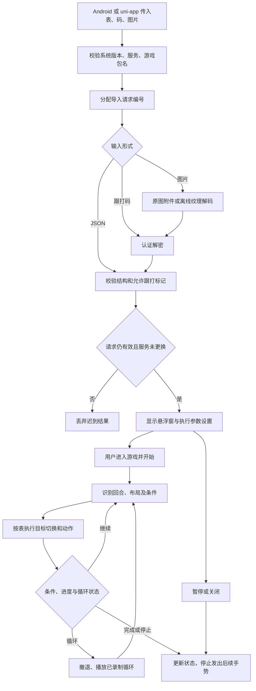

# 全自动跟打独立插件

范围已经按确认冻结：操作表读取、自动执行、条件判断、循环、悬浮窗与参数设置。完整操作表编辑器、宿主编辑器回调、普通图片手抄导入、局域网同步、图鉴/养成/数据采集均不作为插件入口提供。只支持现有如鸢/代号鸢战斗规则，并非任意游戏自动化引擎。

此目录是独立项目。核心源码、图片纹理解码源码、资源和测试均在本目录。原项目 D:/SJS-table/yuan 的本轮改动已恢复并逐文件校验，记录在 audit/original-restoration.json；不会通过构建脚本回写原项目。原项目恢复后另有平板布局调整，已保留，详见 audit/final-original-review.json。没有提交 Git。

## 目录与交付

- follow-core：Android Library，独立 AAR；主要公开入口 com.local.yuanatlas.YuanFollow。
- uni-app/uni_modules/yuan-follow：UTS 接入插件，使用同一 AAR，优先使用此方式。
- follow-uni：传统 UniModule 适配源码，需要对应 HBuilderX 的官方 Android SDK 才能编译。
- demo：最小原生 Android 接入示例。
- host-test：当前 App 的隔离测试副本，独立包名 com.local.yuanatlas.plugintest；仅用于接入回归，不进入发行包。
- src/tests：协议、图片、原生执行器和宿主接入测试。
- output/release：生成的 AAR、UTS 插件和接入说明。

AAR 的安装最低 API 为 24；全自动跟打要求 Android 11 / API 30 以上。实际运行须由用户在系统设置启用宿主的无障碍服务，并在悬浮窗主动勾选开始跟打。加载图片/表格本身不会自动发手势。

## Android 接入

将 output/release/android/yuan-follow-core-1.0.0.aar 放到宿主 app/libs，增加：

```groovy
android {
    compileSdk 35
    compileOptions {
        sourceCompatibility JavaVersion.VERSION_17
        targetCompatibility JavaVersion.VERSION_17
    }
}
dependencies {
    implementation files('libs/yuan-follow-core-1.0.0.aar')
    implementation 'com.google.mlkit:text-recognition-chinese:16.0.1'
    implementation 'androidx.webkit:webkit:1.12.1'
}
```

本地 AAR 不包含 Maven 依赖；两条依赖必须保留。无障碍服务、私有导入页面、通知接收器和相关权限随 AAR Manifest 合并。没有录屏上传或远程图片下载。Android 13+ 的通知展示授权可由宿主申请。

```java
import com.local.yuanatlas.YuanFollow;

// 页面按钮中调用：先让用户在系统设置开启服务。
YuanFollow.openAccessibilitySettings(activity);

// 返回页面后可读取 ready / disabled / disconnected / unsupported。
String state = YuanFollow.status(activity);

// gamePackage 必须是已安装、可启动的实际游戏包名，不是宿主自身。
YuanFollow.chooseImage(activity, gamePackage, (ok, code, message) -> {
    // 回调在主线程；ok 仅表示表已载入，不代表战斗已执行或成功。
    statusView.setText(message);
});

YuanFollow.openTable(activity, gamePackage, tableJson, callback);
YuanFollow.openCode(activity, gamePackage, yrafCode, callback);
YuanFollow.openImage(activity, gamePackage, contentUri, callback);
YuanFollow.pause();  // 保留浮窗和已确认的动作进度。
YuanFollow.close();  // 取消导入，停止执行和循环，关闭浮窗。
```

可通过 addListener/removeListener 订阅 connected、disconnected、loaded、running、paused、round、status、stopped、closed 等事件。离开页面时移除监听；诊断用 diagnostics(context)。没有完整编辑器调用 API，也没有将任意脚本作为手势执行的 API。

## uni-app 接入（UTS）

复制 output/release/uni-app/uni_modules/yuan-follow 到 uni-app 项目 uni_modules，重新制作 Android 自定义基座或正式包。使用 HBuilderX 4+、支持 Java 17/API 35 的打包环境；不能在 H5、标准基座或 iOS 运行。只接入 UTS 或传统 UniModule 其中一种，避免重复包含核心 AAR。

```javascript
import { openSettings, chooseImage, openTable, pause, close, diagnostics }
  from '@/uni_modules/yuan-follow';

openSettings();
chooseImage(gamePackage, result => console.log(result));
openTable(gamePackage, JSON.stringify(table), result => console.log(result));
pause();
close();
```

完整页面示例在 uni-app/example-uts.vue。UTS 只转发 API 和一次性回调，运行进度仍由原生悬浮窗展示。

UTS 的 libs/config.json 接入方式依据 [DCloud UTS 插件文档](https://uniapp.dcloud.net.cn/plugin/uts-plugin.html)；Java 接口实现依据 [DCloud Android UTS 文档](https://uniapp.dcloud.net.cn/plugin/uts-for-android.html)。本项目按当前 App 的 Android WebView 宿主进行集成回归；未将该结果当成 HBuilderX 基座验收。

## 传统 uni.requireNativePlugin 接入（可选源码）

follow-uni/src/main/java/com/yuan/follow/uni/YuanFollowModule.java 提供传统模块。编译需要与使用方 HBuilderX 对应、确实包含 UniModule/UniJSMethod/UniJSCallback 的官方 SDK：

```powershell
node tools/gradle.mjs :follow-uni:assembleRelease -PuniSdkDir=C:/path/to/official-sdk/libs
```

将生成的 follow-uni-release.aar 和核心 AAR 一同放入 uni-app/nativeplugins/Yuan-Follow/android，再按 package.json 接入；示例为 uni-app/example.vue。SDK 自身是 compileOnly，不能打入插件包。参考 [DCloud 原生模块文档](https://nativesupport.dcloud.net.cn/NativePlugin/course/android.html)。官方 GitHub 旧示例 SDK 只有旧 WXModule API，不能用于当前 UniModule 源码；因此本次不把传统模块标为已编译产物。

## 输入协议及限制

结构化输入沿用 yuan-recorder-local-table / version:1，示例在 src/tests/fixtures/table.json：game、tableName、roleName、5 个 agents、state.slots、state.rounds 及 state.allowAutoFollow。game 只能是 ruYuan 或 codeYuan。插件保留作者和授权；allowAutoFollow:false 会拒绝，不自动改为允许。

跟打码支持 YRAF1 / YRAF0001 公共协议，兼容原设备已有旧密钥的旧码。跨 App 不迁移旧设备私有密钥，旧码缺少对应密钥时需要重新导出公共码。图片优先读取 YRAFIMG1 附件，再尝试 follow-v2 / follow-v1 纹理；附件损坏不阻止有效纹理恢复。没有有效码则报错，不把 OCR 猜出的普通表变成可执行任务。

JSON 最大 1 MiB，图片最大 12 MiB、5000 万像素，只接受本地 content URI 或系统选择器返回图片。错误回调包含 NOT_READY、INVALID_TARGET、INVALID_TABLE、INVALID_CODE、INVALID_IMAGE、NOT_ALLOWED、DISCONNECTED、CANCELLED、TIMEOUT 等；新导入、关闭、页面结束或服务重连后，旧结果不能覆盖新会话。

## 功能流程



流程中没有完整编辑器，也没有调用宿主编辑器的支路。

## 构建与测试

使用 JDK 17、Gradle 8.13、Android SDK 35 / Build Tools 35.0.0；local.properties 配置本机 sdk.dir。tools/gradle.mjs 默认 Windows 安装路径，可通过 JAVA_HOME、GRADLE_HOME 覆盖。它将缓存和 Android 用户目录放在本项目 .tooling。

```powershell
npm install
npm run build:decoder
npm test
npm run build:android
node tools/gradle.mjs :demo:assembleDebugAndroidTest
node tools/package.mjs
```

生成当前 App 隔离宿主：node tools/prepare-host-test.mjs D:/path/to/yuan。该脚本只读来源，将 src/main 复制到本项目 host-test，排除核心重复类并使用独立测试包名；不复制签名和存档。host-test 已存在时会拒绝覆盖。

完整验证范围和实际结果见 docs/验证记录.md。真实 OCR + 模拟手势通过不代表真实游戏战斗、所有机型或 HBuilderX 基座已验收。
